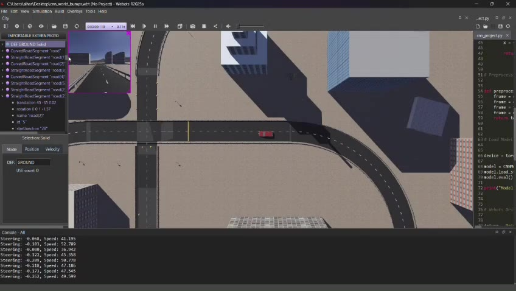
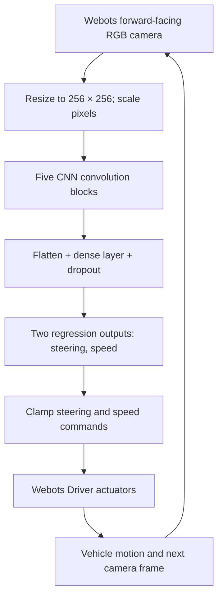
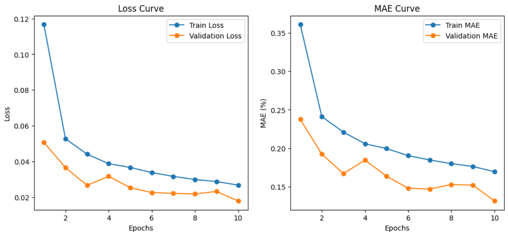

# Autonomous-driving-using-computer-vision

**End-to-end CNN regression for camera-based steering and speed control in a simulated vehicle.**



**[Watch the full robot demonstration](assets/robot_demo.mp4)** · [Training notebook](CNN_training.ipynb) 

## Overview

Autonomous navigation requires a robot to interpret visual observations and translate them into timely control decisions. This cognitive robotics project explores **behavioral cloning / end-to-end supervised control**: a convolutional neural network (CNN) learns to predict continuous **steering** and **speed** commands from front-facing RGB camera frames. A Webots vehicle controller then repeatedly captures images, runs inference, constrains the predicted commands, and applies them to the simulated car.

The project combines computer vision, supervised regression, and a real-time **perception → action** loop. Unlike a manually coded lane-following controller, the driving policy is learned from labeled simulation frames.

## Highlights

- **CNN contains five convolutional layers** with batch normalization, ReLU, and max pooling, followed by a 256-unit dense layer and a two-output regression head.
- **Camera-to-control mapping** from 256 × 256 RGB frames to `[steering, speed]` predictions.
- **Supervised training** using PyTorch, Adam, and Smooth L1 loss; separate mean absolute error (MAE) monitoring.
- **Webots integration** using the vehicle `Driver` API and a forward-facing camera.
- **Scenario evaluation** covering turns, speed bumps, and obstacle-handling demonstrations.

## Demonstration

The repository includes the original **3-minute 28-second** simulation recording:

[](assets/robot_demo.mp4)

[View / download robot demonstration video](assets/robot_demo.mp4)

The demonstration is evidence of observed simulated behavior, not a quantitative safety benchmark.

## System architecture



### Perception

A front-facing camera provides images of the simulated driving scene. The original training notebook resizes frames to 256 × 256, converts them to tensors, and applies brightness augmentation during training. The deployment controller preprocesses each camera image for inference.

### Learning

The network uses five 3 × 3 convolution layers with output channels **16 → 32 → 64 → 96 → 128**, batch normalization, ReLU, and 2 × 2 max pooling. A flattened 8 × 8 × 128 feature tensor feeds a **256-unit fully connected layer**, dropout of **0.3**, and a final two-value output layer.

| Configuration | Implementation |
|---|---|
| Framework | PyTorch |
| Input | RGB image, 256 × 256 |
| Prediction order | `[steering, speed]` |
| Optimization objective | `SmoothL1Loss` |
| Optimizer | Adam, learning rate `1e-4` |
| Batch size | 32 |
| Training epochs | 10 |
| Monitored metric | Mean absolute error |


### Action

During Webots execution, the controller runs inference on the latest frame and applies the predicted values to the simulated car. The supplied implementation clips steering to **[-0.5, 0.5]** and speed to **[10, 80]** after applying its output scaling (`abs(speed_prediction) × 100`). These are basic actuator bounds, not formal safety guarantees. The physical units and label normalization should be verified against the original dataset and simulator configuration.

## Dataset

The project uses the publicly referenced **[Webots dataset on Kaggle](https://www.kaggle.com/datasets/janbrzozowski/webots)**, with synthetic camera frames and CSV labels for steering and speed. The project report states:

| Split | Samples reported |
|---|---:|
| Training | 22,000 |
| Validation | 4,897 |
| Testing | 4,898 |

Each example pairs an image with a continuous steering/speed target. The original notebook loads `std_train_data.csv` and `std_test_data.csv`; it does **not** currently load the separately reported validation split.

## Results

### Training curves



### Simulation scenarios

| Scenario | Reported outcome | Scope |
|---|---|---|
| Curved-road navigation | **83%** | Six curve trials; one successful turn with excessive speed was not counted as fully successful |
| Speed-bump handling | **83%** | Six bump trials; one passage had excessive speed |
| Obstacle-handling / lane-change scenarios | **100%** | Three reported road scenarios |

Approximately **15% GPU utilization (RTX 4090)** and **7% CPU utilization (Intel i7)** during a specific simulation run, with camera capture approximately every **50 ms**.

## Repository layout

```text
webots-vision-autonomous-driving/
├── README.md
├── notebooks/
│   └── training_experiments.ipynb   # Original training + controller notebook
├── src/
│   └── model.py                     # Extracted CNN architecture
├── controllers/
│   └── autonomous_driver/
│       ├── autonomous_driver.py     # Extracted Webots control loop
│       └── model.py                 # Local architecture for Webots imports
├── assets/
│   ├── robot_demo.mp4
│   ├── demo_preview.jpg
│   └── training_curves_report.png
├── docs/
│   └── ENGINEERING_NOTES.md
├── requirements.txt
├── .gitignore
└── LICENSE_NOTE.md
```

## Getting started

### 1. Prerequisites

- Python 3.10+ is a reasonable starting point, but the original project did **not** record a tested Python version.
- PyTorch and the dependencies in `requirements.txt`.
- [Webots](https://cyberbotics.com/) with vehicle-controller support for simulation.
- Access to the Kaggle dataset; training benefits from a GPU.

The original **Webots world files and trained `cnn_project.pth` checkpoint were not supplied**, so full simulator reproduction requires those additional artifacts or an equivalent compatible world.

### 2. Set up a Python environment

```bash
python -m venv .venv
source .venv/bin/activate   # Windows: .venv\Scripts\activate
pip install -r requirements.txt
```

Package versions are intentionally not claimed as verified; pin a tested environment before relying on reproducible runs.

### 3. Obtain the dataset

The original notebook begins with:

```python
import kagglehub
path = kagglehub.dataset_download("janbrzozowski/webots")
print(path)
```

**Important:** Later notebook cells hard-code `/kaggle/input/webots/data_splits/...` image paths. Update those paths to point to the actual downloaded dataset directory if running in Colab or locally.

### 4. Train the CNN

Open [`notebooks/training_experiments.ipynb`](notebooks/training_experiments.ipynb) in Jupyter or Colab. Run the data-loading, model, and training sections in order. **Do not run the Webots controller cell in a regular notebook environment**: it requires the simulator's `vehicle` module and an active robot controller.

Before treating the experiment as reproducible, create a true validation loader and update the training loop to use it. The original notebook saves a model state dictionary as `cnn_project.pth`.

### 5. Run inference in Webots

1. Use a Webots world containing a compatible vehicle with a camera device named `camera`.
2. Copy `controllers/autonomous_driver/` into the world's controller directory, or configure an equivalent controller path.
3. Place the trained `cnn_project.pth` alongside `autonomous_driver.py` and `model.py`.
4. Configure the vehicle to use the `autonomous_driver` controller and ensure the controller's Python environment has the necessary packages.
5. Start the Webots simulation and inspect the vehicle's steering and speed behavior.

**Status:** This extracted controller preserves the original notebook's model architecture and control logic, but has **not been executed against the user's Webots world**. The checkpoint and world are required to validate it. Confirm camera channel order and speed units before interpreting behavior.

## Future work

- Add explicit obstacle sensing or safety supervision, such as distance sensors, where appropriate.
- Investigate imitation-learning improvements and reinforcement-learning fine-tuning in simulation.


## References and credits

- [Webots — Cyberbotics](https://cyberbotics.com/)
- [Webots automobile documentation](https://cyberbotics.com/doc/automobile/introduction?tab-language=python)
- [Webots driving dataset — Jan Brzozowski, Kaggle](https://www.kaggle.com/datasets/janbrzozowski/webots/data)
- [NVIDIA: End-to-End Deep Learning for Self-Driving Cars](https://developer.nvidia.com/blog/deep-learning-self-driving-cars/)
- [Ilya Kolosov — Webots traffic controller example](https://github.com/IlyaKolosov1/Self_Driving_Car_Webot/blob/main/Webots_auto_car_11/controllers/traffic_control_car/traffic_control_car.py)
- [Marco Daniel Cameros — autonomous car example](https://github.com/marcodanielcameros/autonomous-car/blob/main/simple_controller-1.py)
